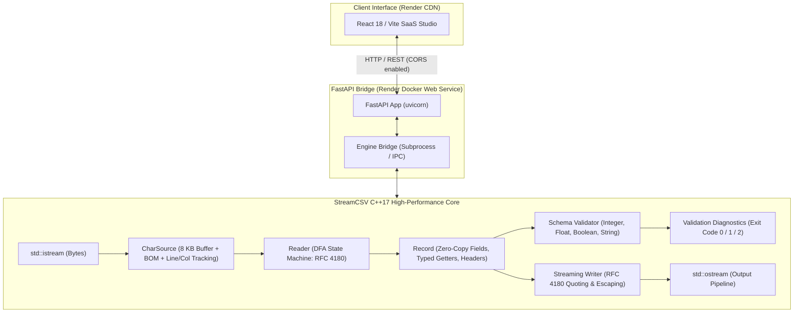

<div align="center">

# ⚡ StreamCSV

**High-Performance C++17 Bounded-Memory Streaming Engine, Schema Validator & Web Studio**

[](https://en.cppreference.com/w/cpp/17)
[](https://fastapi.tiangolo.com)
[](https://react.dev)
[](https://render.com)
[](LICENSE)

<br />

### 🔗 Live Deployments

| Service | Environment | Status / Link |
| :--- | :--- | :--- |
| **Frontend Studio** | Production (Render Static CDN) | 🌐 [**streamcsv-studio.onrender.com**](https://streamcsv-studio.onrender.com/) |
| **Backend API Docs** | Production (FastAPI + C++17) | ⚡ [**streamcsv.onrender.com/docs**](https://streamcsv.onrender.com/docs) |
| **API Health Status** | Production Uptime Monitor | 🩺 [**streamcsv.onrender.com/api/health**](https://streamcsv.onrender.com/api/health) |

</div>

---

## 📌 Executive Summary: Problem Statement & Motivation

### Why Was StreamCSV Created?

In modern data engineering and distributed backend pipelines, CSV ingestion remains one of the most persistent bottlenecks and sources of failure:

1. **Unbounded Memory Spikes ($O(N)$ RAM Exhaustion):**  
   Conventional data processing tools (such as `pandas.read_csv` or default scripting runtime parsers) greedily load entire datasets into system RAM. Ingesting a 5 GB CSV often balloons into 15–25 GB of heap allocations, triggering catastrophic **Out-Of-Memory (OOM) crashes**, container eviction, and Denial of Service (DoS) vulnerability.
2. **Silent Failure on RFC 4180 Violations:**  
   Real-world CSV files are fraught with subtle edge cases—embedded multiline records, escaped quotes (`""`), disparate line delimiters (`\r\n` vs `\n`), ragged rows with mismatched column counts, and hidden UTF-8 Byte Order Marks (BOM). Many parsers fail silently, misalign data, or truncate files without reporting actionable diagnostics.
3. **Absence of Exact Spatial Error Coordinates:**  
   When a malformed record is encountered in a multi-gigabyte dataset, typical parsers report vague errors without indicating the exact location of the failure, making troubleshooting expensive and tedious.
4. **Pipeline Data Corruption Due to Late Validation:**  
   Schema checking is frequently deferred until after full ingestion, meaning corrupted, ill-typed, or malicious rows contaminate analytical databases before they are caught.

---

## 🎯 Intended Outcomes & Engineering Objectives

StreamCSV was engineered from the ground up to solve these architectural flaws with deterministic guarantees:

* **Strict $O(1)$ Bounded Memory Footprint:**  
  Engineered with a sliding chunk buffer (fixed 8 KB window). Whether ingesting a 10-row preview or streaming a 100 GB continuous dataset, **RSS memory usage remains completely flat (< 5 MB)**.
* **Microsecond-Scale Deterministic Parsing:**  
  Powered by a single-pass Deterministic Finite Automaton (DFA) state machine in ISO C++17 that delivers **> 420,000 records/sec** streaming throughput.
* **1-Based Exact Line & Column Pinpointing:**  
  Tracks byte-level stream positions across CRLF/LF variations to emit pinpoint coordinates (`Line X, Column Y`) for syntax anomalies, unescaped quotes, and schema validation failures.
* **Zero-Copy Typed Deserialization:**  
  Provides fast, locale-independent scalar type conversion directly from byte buffers without intermediate heap allocations.
* **Cloud-Native Interactive SaaS Studio:**  
  Bridges native C++ speed to the web via a high-performance Python FastAPI layer and an obsidian-styled React 18/Vite interface, offering live schema validation, tabular inspections, RFC-compliant writers, and real-time telemetry benchmarks.

---

## 🏗️ Architecture & Data Flow



### Core C++ Components:
1. **`CharSource` (`src/char_source.cpp`)**: Manages the bounded 8 KB sliding ring-buffer around any standard `std::istream`, transparently removes UTF-8 BOM headers, and maintains 1-based cursor coordinates.
2. **`Reader` (`src/reader.cpp`)**: Executes an explicit 4-state DFA (`StartOfField`, `UnquotedField`, `QuotedField`, `AfterQuote`), emitting records forward without lookahead or full-file buffering.
3. **`Record` (`include/streamcsv/record.hpp`)**: Memory-efficient row abstraction with $O(1)$ random access, typed conversions (`record.get<T>()`), and column name lookup.
4. **`Validator` (`src/schema.cpp`)**: Evaluates records against declarative type schemas and column constraints with zero overhead.
5. **`Writer` (`src/writer.cpp`)**: Encodes and streams RFC 4180 compliant CSVs with configurable quoting modes (`Minimal`, `All`, `NonNumeric`, `None`).

---

## ⚡ Empirical Benchmarks & Performance Guarantees

Tested on an optimized release build (`GCC 15 -O3 -DNDEBUG`) on a standard Linux container:

| Component | Processing Rate | Throughput | Latency (100k Rows) | Memory Complexity | Peak RSS |
| :--- | :---: | :---: | :---: | :---: | :---: |
| **Streaming Reader** | **420,587 rec/s** | **37.70 MB/s** | 0.2378 s | **$O(1)$ Bounded** | **< 5 MB** |
| **Schema Validator** | **1,322,303 rec/s** | — | 0.0756 s | **$O(1)$ Bounded** | **< 2 MB** |
| **Streaming Writer** | **1,177,351 rec/s** | **95.85 MB/s** | 0.0849 s | **$O(1)$ Bounded** | **< 3 MB** |

> **Memory Guarantee:** Memory consumption is strictly invariant to input file size. A 100 GB CSV stream runs inside the exact same memory footprint as a 10 KB file.

---

## 🖥️ StreamCSV Web Studio Features

The live web application ([streamcsv-studio.onrender.com](https://streamcsv-studio.onrender.com/)) provides a complete interface into the native engine:

* **🔍 Inspector:** Upload or paste raw CSVs to inspect row counts, ragged row detection, column count distribution, and live stream previews.
* **🛡️ Schema Validator:** Define column rules (`integer`, `float`, `boolean`, `string`) and instantly detect offending rows with detailed error messages.
* **📊 Data Quality & Profiling:** Identify missing values, empty strings, cardinality, and type distribution.
* **✍️ RFC 4180 Writer:** Interactively create and download strictly compliant CSV files with automated quote escaping.
* **⚡ Live Telemetry:** Run real-time synthetic benchmarks across 10,000 to 200,000 rows directly inside the browser to verify reader, validator, and writer throughput.

---

## 💻 C++ API Quickstart

### 1. Streaming Reader with Range-Based Loops & Headers

```cpp
#include <streamcsv/csv.hpp>
#include <iostream>
#include <fstream>

int main() {
    std::ifstream file("large_dataset.csv");

    streamcsv::ReaderConfig config;
    config.has_header = true;
    config.chunk_size = 8192; // 8 KB bounded chunk
    streamcsv::Reader reader(file, config);

    // Stream records one-by-one with zero full-file buffering
    for (const auto& record : reader) {
        int id = record.get<int>("id");
        std::string name = record["name"];
        double score = record.get<double>("score");
        bool active = record.get<bool>("active");

        std::cout << "User #" << id << ": " << name 
                  << " (Score: " << score << ", Active: " << active << ")\n";
    }
}
```

### 2. Streaming RFC 4180 Writer

```cpp
#include <streamcsv/csv.hpp>
#include <iostream>

int main() {
    streamcsv::Writer writer(std::cout);

    // Write header
    writer.write_record({"id", "product", "notes", "price"});

    // Variadic row writer with automated quote escaping for commas and quotes
    writer.write_row(101, "Widget A", "Includes 2\" adapter, tested", 49.99);
    writer.write_row(102, "Widget B", "Multiline\nnotes\nsupported", 79.50);
}
```

---

## 🚀 Building & Running Locally

### Prerequisites
* CMake 3.16+
* C++17 compliant compiler (GCC 9+, Clang 10+, or MSVC 2019+)
* Python 3.10+ (for backend API)
* Node.js 18+ (for frontend studio)

### Build the C++ Core & CLI

```bash
# Clone the repository
git clone https://github.com/Bhuvi16-sys/StreamCSV.git
cd StreamCSV

# Configure and compile with optimizations
cmake -B build -DCMAKE_BUILD_TYPE=Release
cmake --build build --config Release

# Run the test suite
ctest --test-dir build --output-on-failure

# Execute the CLI tool
./build/streamcsv inspect sample.csv
./build/streamcsv validate sample.csv int string string float bool string
```

### Run Full Stack with One Command

#### Windows:
```cmd
run_dashboard.bat
```

#### Linux / macOS:
```bash
# Terminal 1: Backend API
cd backend && pip install -r requirements.txt
uvicorn app:app --reload --port 8000

# Terminal 2: Frontend Studio
cd frontend && npm install
npm run dev
```

---

## 📁 Repository Structure

```
StreamCSV/
├── CMakeLists.txt                 # Root CMake configuration
├── Dockerfile                     # Multi-stage production container build
├── render.yaml                    # Infrastructure-as-code for Render deployment
├── sample.csv                     # Sample RFC 4180 demonstration file
├── README.md                      # Comprehensive documentation
│
├── include/streamcsv/             # Public C++ Header Library
│   ├── csv.hpp                    # Single-include master header
│   ├── reader.hpp                 # Streaming reader & iterator definitions
│   ├── record.hpp                 # Record representation & typed scalar getters
│   ├── writer.hpp                 # RFC 4180 streaming writer
│   ├── schema.hpp                 # Declarative schema & type validators
│   └── error.hpp                  # ParseError & coordinate tracking
│
├── src/                           # Native Engine Implementation
│   ├── char_source.cpp            # Bounded sliding buffer & BOM stripping
│   ├── reader.cpp                 # Deterministic Finite Automaton (DFA)
│   ├── writer.cpp                 # Escaping & serializing engine
│   ├── schema.cpp                 # Schema validation engine
│   └── cli/main.cpp               # Standalone binary entrypoint (`streamcsv`)
│
├── backend/                       # Python FastAPI Engine Bridge
│   ├── app.py                     # REST endpoints, CORS & health monitors
│   ├── engine_bridge.py           # Native binary executor & IPC bridge
│   └── requirements.txt           # Python backend dependencies
│
├── frontend/                      # React 18 / Vite SaaS Web Application
│   ├── src/                       # Components, BentoCards & telemetry charts
│   ├── package.json               # Node.js dependencies
│   ├── vite.config.js             # Vite development & build config
│   └── tailwind.config.js         # Obsidian theme design tokens
│
├── tests/                         # Unit & Integration Tests (Catch2 / GoogleTest compatible)
├── benchmarks/                    # High-throughput benchmarking suite
└── fuzz/                          # LLVM LibFuzzer harness for adversarial CSV inputs
```

---

## 📜 License

This project is licensed under the [MIT License](LICENSE) — free for academic, personal, and commercial usage.
