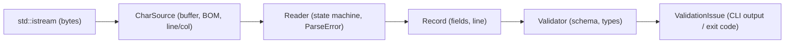

# StreamCSV Architecture

## Architectural Flow

The StreamCSV pipeline processes data in a strictly linear, forward-only stream:

---

## Component Separation

1. **`CharSource` (`src/char_source.cpp`)**:
   - Manages a fixed-size buffer (default 8 KB) around an `std::istream`.
   - Handles byte-level concerns such as UTF-8 BOM stripping.
   - Accurately tracks 1-based `line` and `column` positions across all newline variants (`\n`, `\r\n`, `\r`).

2. **`Reader` (`src/reader.cpp`)**:
   - Implements a deterministic finite automaton (DFA) state machine:
     - `StartOfField`
     - `UnquotedField`
     - `QuotedField`
     - `AfterQuote`
   - Emits `Record` structures on demand via `next_record()` without buffering future rows.

3. **`Record` (`include/streamcsv/record.hpp`)**:
   - Represents a single parsed row in memory.
   - Provides $O(1)$ random access, size checks, iteration, and originating line numbers.

4. **`Validator` (`src/schema.cpp`)**:
   - Evaluates a `Record` against a declarative `Schema`.
   - Verifies column counts, non-empty requirements, and scalar types (`Integer`, `Float`, `Boolean`, `String`).
   - Produces a list of detailed `ValidationIssue` reports.

5. **`CLI` (`src/cli/main.cpp`)**:
   - Provides commands: `inspect` and `validate`.
   - Returns standard Unix exit codes:
     - `0`: Success / valid
     - `1`: Validation issues found
     - `2`: Parse errors or I/O failure
